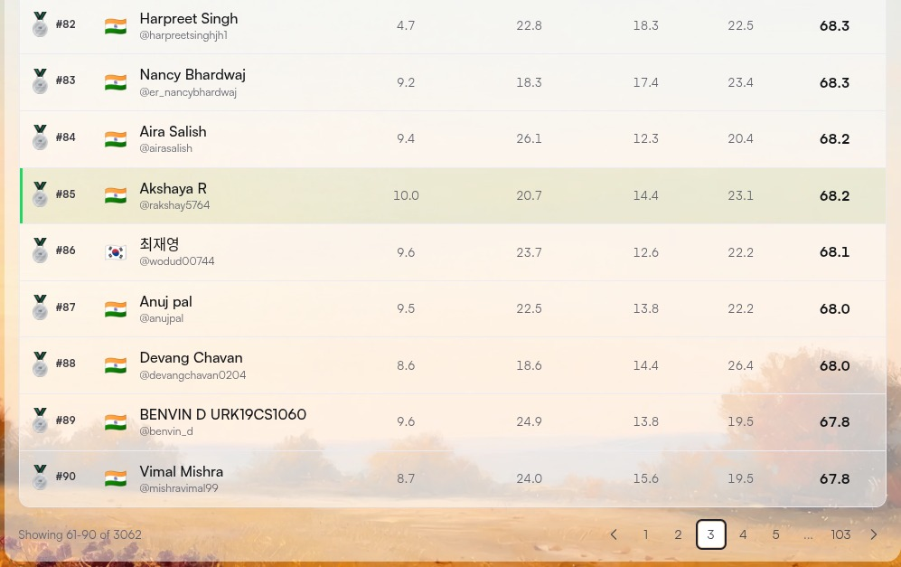
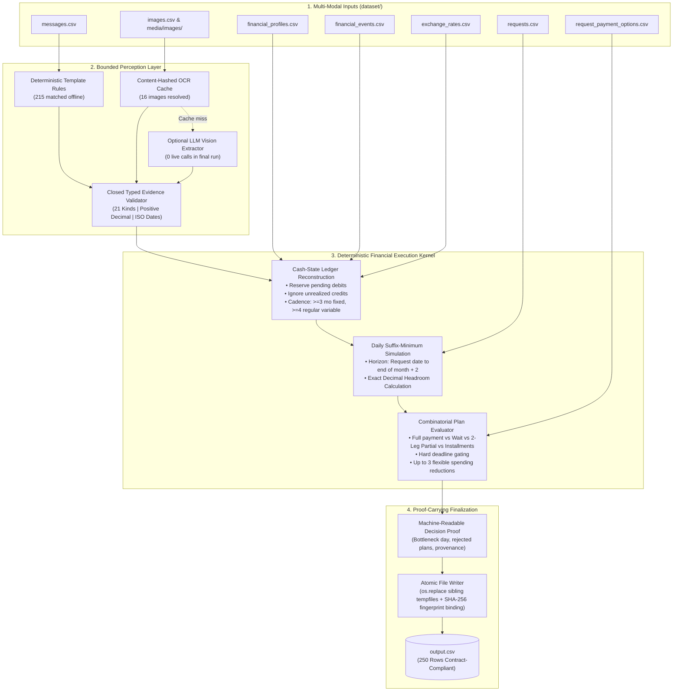

# Buy or Wait? — Deterministic Financial Affordability Engine

[](docs/assets/hackerrank_orchestrate_leaderboard_row85.png)
[](docs/assets/hackerrank_orchestrate_result_banner.png)
[](docs/assets/hackerrank_orchestrate_result_banner.png)
[](code/buyorwait/money.py)
[](docs/TEST_VERIFICATION_SUMMARY.md)

> **Official competitive submission for the HackerRank Orchestrate 24-Hour Hackathon (September 2026).**
> Developed by **Akshaya R** ([@AkshayAlgoX](https://github.com/AkshayAlgoX)).
> **Final Placement:** Global Rank **#85 out of 3,062** participants (**Top ~2.78%**), scoring **68.2 / 100**.

---

## Overview

**Buy or Wait?** is an offline, constraint-based personal financial decision engine. Given 250 evaluation requests across 5 currencies (INR, USD, EUR, IDR, ZAR), historical transaction ledgers, pending authorizations, salary schedules, and unstructured context messages/receipts, the engine evaluates whether a user can afford a requested purchase today (`affordable_now`), through structured installments or a two-payment schedule (`affordable_with_plan`), by waiting for a safe liquidity window (`affordable_later`), or not at all (`not_affordable`).

Within the modeled cash-flow events, recognized recurring commitments, and the calendar forecast horizon, the engine enforces the strict invariant that the user's projected balance must remain at or above `minimum_balance_to_keep` on every simulated calendar day.

### Three Distinctive Technical Contributions

1. **Separation of Perception and Financial Authority:** Large Language Models and template parsers are strictly isolated as untrusted evidence extractors. Extracted data must validate against a closed 21-kind typed schema ([`evidence.py`](code/buyorwait/evidence.py)). Models have no mechanical capability to modify balances, alter foreign exchange rates, adjust deadlines, or rank plans.
2. **Fail-Closed Cash Accounting:** In [`ledger.py`](code/buyorwait/ledger.py), pending debits are reserved immediately on their cash date, while pending credits and unrealized investments are excluded. Debits with unresolvable missing amounts from damaged or missing receipts trigger `UnresolvedCashEvidence`, causing the request to fail closed conservatively rather than guessing zero.
3. **Deterministic Execution & Zero Model Cost:** The final submitted run evaluated all 250 requests with **0 live LLM calls** ($0.00 API cost), resolving 215 items via offline deterministic regex templates and 16 items via content-hashed image extractions. Exact decimal arithmetic avoids IEEE 754 binary floating-point rounding errors. Every decision is accompanied by a machine-readable JSON proof ([`pipeline.py`](code/buyorwait/pipeline.py)) and bound to engine code hashes via atomic file replacement ([`atomic.py`](code/buyorwait/atomic.py)).

---

## Authentic Competition Proof & Leaderboard Verification

The submission was officially scored and ranked on the HackerRank Orchestrate leaderboard upon competition close on September 13, 2026.

| Metric | Official Result | Verification Source |
| :--- | :--- | :--- |
| **Global Rank** | **#85** of 3,062 participants | [HackerRank Summary Banner](docs/assets/hackerrank_orchestrate_result_banner.png) |
| **Percentile** | **Top ~2.78%** | [Official Leaderboard Row #85](docs/assets/hackerrank_orchestrate_leaderboard_row85.png) |
| **Final Score** | **68.2 / 100** | Category Breakdown: `10.0` \| `20.7` \| `14.4` \| `23.1` |
| **Submission Output** | **250 / 250 requests** | Generated via `python3 code/main.py --no-model` with 0 schema defects |
| **Recorded Tests** | **847 passed, 4 xfailed** | Detailed audit: [`docs/TEST_VERIFICATION_SUMMARY.md`](docs/TEST_VERIFICATION_SUMMARY.md) |
| **Adversarial Cases** | **15 / 15 passed** | Implemented in [`code/evaluation/adversarial/cases.py`](code/evaluation/adversarial/cases.py) |

*(Note: The live contest leaderboard is hosted within HackerRank's authenticated contest portal. Authentic official screenshots captured from the contestant dashboard are displayed below).*




---

## System Architecture

The system pipeline strictly isolates untrusted perception from deterministic financial calculation:



---

## Engineering Deep-Dive & Implementation Details

### 1. Bounded Perception Layer ([`code/buyorwait/extraction/agent.py`](code/buyorwait/extraction/agent.py))
* **Template Rules First ([`rules.py`](code/buyorwait/extraction/rules.py)):** Unstructured messages are parsed against deterministic regular expression templates covering English and Indonesian idioms. Matches yield typed `Evidence` directly without external API calls.
* **Closed Vocabulary Validator ([`evidence.py`](code/buyorwait/evidence.py)):** Extracted records must validate against 21 closed schema kinds (`salary_amount_change`, `one_off_income`, `recurring_expense_added`, etc.). Amounts must be positive finite decimals; dates must be ISO format.
* **Bounded Schema Containment (Prompt Isolation):** Untrusted input strings are delimited in extraction prompts. The defense against prompt injection does not rely on model compliance; instead, the extractor interface is strictly constrained to populate predefined schema fields. Any payload attempting to alter account balances, forgive debts, or inject instructions is discarded during validation and quarantined under the `scam_or_injection` kind.

### 2. Cash-State Reconstruction ([`code/buyorwait/ledger.py`](code/buyorwait/ledger.py))
* **Conservation Rules:** Settled history is fixed. Pending and scheduled debits are reserved on their respective cash dates. Pending credits, failed transactions, and unrealized investments never increment available balances.
* **Recurring Expense Cadence Detection:**
  * *Fixed Commitments:* Requires at least 3 settled occurrences with 26–35 day intervals.
  * *Variable Categories:* Requires at least 4 settled occurrences where at least 80% of intervals fall within 1 day of the median gap (minimum median: 2 days). Projected at the historical mean with outliers (> 3x median) excluded.
* **Fail-Closed Missing Amounts:** Debits with missing amounts in `financial_events.csv` require image or message resolution. If unresolved, `UnresolvedCashEvidence` triggers a conservative fail-closed fallback rather than defaulting to zero.

### 3. Suffix-Minimum Forecasting Engine ([`code/buyorwait/forecast.py`](code/buyorwait/forecast.py))
* **Horizon Definition:** The forecast window runs from `request_date` to the final day of the second calendar month following the request month (59–91 days depending on calendar placement). This calendar-aligned reading was chosen because it reproduces solved golden samples where fixed 90-day offsets fail.
* **Mathematical Headroom:** Flows are netted per day using pure Python [`Decimal`](code/buyorwait/money.py) arithmetic. For any simulated day $t$, available headroom is calculated as:
  $$\text{Headroom}(t) = \min_{\tau \ge t} \big( \text{Balance}(\tau) \big) - \text{MinimumBalanceToKeep}$$
  `amount_safe_to_pay` is the headroom on `request_date`, clamped to `[0, requested_amount]`.
* **Capacity Scanning:** `earliest_date_for_full_payment` is determined by scanning forward from `request_date` to identify the first day on which paying the full requested amount maintains the suffix-minimum balance at or above `minimum_balance_to_keep` across all subsequent forecast days.

### 4. Constrained Plan Ranking ([`code/buyorwait/planning.py`](code/buyorwait/planning.py), [`code/buyorwait/spending.py`](code/buyorwait/spending.py))
* **Candidate Generation:** Generates valid candidate options:
  1. `full_payment` today if `amount_safe_to_pay == requested_amount`.
  2. `wait` until `earliest_date_for_full_payment`.
  3. `partial_payment` (exactly two payments: `amount_safe_to_pay` on `request_date`, balance on `earliest_date_for_full_payment`).
  4. `installments` matching seller-provided options within `max_installment_months`.
* **Hard Deadline Gating:** Candidates whose final payment falls after `desired_completion_date` are disqualified before ranking. A late plan can never win simply by being the sole candidate.
* **Flexible Spending Reductions:** If an attractive plan is unsafe, the engine exhaustively evaluates combinations of up to 3 reductions (`stop:<event_id>` or `reduce_to:<event_id>:<amount>`), strictly restricted to recurring, non-essential categories marked flexible by the user.
* **Deterministic Ranking Tuple:** Surviving candidates are sorted ascending by `Plan.rank_key()` in [`code/buyorwait/planning.py`](code/buyorwait/planning.py):
  ```python
  (
      0 if self.completes_by_deadline else 1,   # 1. on-time first (always 0 here: late plans are rejected before ranking)
      1 if self.changes else 0,                 # 2. plans needing no spending changes first
      self.total_paid,                          # 3. lowest total paid (Decimal)
      self.first_date,                          # 4. earliest first payment (date)
      len(self.payments),                       # 5. fewest payments
      self.option.option_index if self.option else 0,  # 6. payment-option order; 0 for full payment / wait
  )
  ```

### 5. Crash-Safe Atomic Finalization ([`code/buyorwait/atomic.py`](code/buyorwait/atomic.py))
* File writers (`output.csv`, proof JSON, cache updates) generate temporary sibling files using `tempfile.mkstemp` in the target directory and replace them via atomic `os.replace`. An unexpected process interruption leaves existing output intact.
* Output files and engine code are hashed with SHA-256 into the run metadata published in [`usage_report.md`](code/evaluation/usage_report.md), guaranteeing traceability between code state and output data.

---

## Technical Verification & Test Results

### Recorded Test Evidence vs. Review-Time Verification

To maintain strict auditability, historical competition evidence is distinguished from tests executed during repository reviews:

| Stage | Scope | Result | Source / Verification Method |
| :--- | :--- | :--- | :--- |
| **Recorded Unit Suite** | Full pytest test directory (`code/tests/`) | **847 passed, 4 xfailed** (33.34s) | Detailed audit: [`docs/TEST_VERIFICATION_SUMMARY.md`](docs/TEST_VERIFICATION_SUMMARY.md) |
| **Recorded Adversarial** | 15 property cases (`cases.py`) | **15 / 15 passed** | Implemented in [`code/evaluation/adversarial/cases.py`](code/evaluation/adversarial/cases.py) |
| **Review Execution** | Output contract validator | **250 / 250 rows valid** (0 errors, 5 warnings) | Executed: `python3 code/evaluation/validate_output.py` |
| **Review Execution** | Multi-stage evaluation runner | **PASS** (0.88s) | Executed: `python3 code/evaluation/run_all.py --stages samples,adversarial,output` |

### Explanation of the 5 Validation Warnings

During output contract validation, the script logs 5 soft warnings:
```text
warn request_78:  not_affordable but earliest_date_for_full_payment is set (2025-10-15)
warn request_114: not_affordable but earliest_date_for_full_payment is set (2026-01-15)
warn request_125: not_affordable but earliest_date_for_full_payment is set (2025-11-15)
warn request_131: not_affordable but earliest_date_for_full_payment is set (2025-07-23)
warn request_139: not_affordable but earliest_date_for_full_payment is set (2024-11-15)
```
**Engineering Cause:** In each of these 5 requests, the user cannot complete payment before their specified `desired_completion_date` (e.g., `request_78` deadline is `2025-10-14`, but safe capacity is reached on `2025-10-15`). Because deadline compliance is a hard gate, the decision engine correctly assigns `not_affordable` and `not_recommended`. However, the engine continues to populate `earliest_date_for_full_payment` with the earliest forecast safe date, matching the convention observed in the competition's reference samples. The contract validator flags these as warnings to highlight that capacity exists after the deadline.

### Explanation of the 4 Strict `xfail` Test Cases

Four tests in `code/tests/` are marked `xfail(strict=True)` to document intentional edge-case divergences from the reference samples:
1. `request_06`: Golden sample marks `affordable_with_plan`; our engine projects slightly higher variable spending, conservatively classifying it as `not_affordable`.
2. `request_11`: Golden sample selects July for full payment; our engine identifies an earlier safe window in June.
3. `request_19`: A minor divergence (under 3%) in partial payment split amounts resulting from variable spending mean estimation.
4. `request_21`: Conservative vs. aggressive variable spending drawdown variance (1.9%).

---

## Adjudicated Readings & Documented Tradeoffs

When building the engine against competition specifications, several ambiguous requirements were adjudicated based on empirical testing against `dataset/sample_requests.csv`:

1. **Calendar Month Horizon vs. Fixed 90 Days:** The specification referred informally to "the next 90 days." Testing demonstrated that three golden sample rows (`request_08`, `_12`, `_13`) are matched only when bills falling on days 87–90 are excluded by the end of the second calendar month. A literal 90-day offset misaligns with these reference rows.
2. **Variable Spending Estimation Heuristic:** The reference generator used an unspecified parametric model for variable recurring expenses. Our engine projects regular categories using an unbiased historical mean (80% cadence match). This accounts for minor decimal differences in 4 out of 25 reference samples while remaining mathematically explainable.
3. **Conservative Bill Retries:** When an automated bill retry is scheduled after a failure, the engine reserves the pending retry debit while continuing to project that month's recurring bill. This incurs ~1 extra bill of drawdown across 6 requests, deliberately prioritizing financial conservatism over optimistic assumptions.

---

## Project Structure

```text
hackerrank-orchestrate-september26-akshay/
├── code/
│   ├── ARCHITECTURE.md                  # Comprehensive technical design document
│   ├── main.py                          # Primary CLI execution entry point
│   ├── requirements.txt                 # Dependencies (standard library runtime; pytest/hypothesis for tests)
│   ├── buyorwait/                       # Core financial decision package
│   │   ├── atomic.py                    # Atomic file replacement via os.replace
│   │   ├── evidence.py                  # Closed 21-kind typed schema validator
│   │   ├── forecast.py                  # Suffix-minimum cash simulation & headroom calculation
│   │   ├── fingerprint.py               # SHA-256 code integrity hashing
│   │   ├── fx.py                        # Dated multi-currency foreign exchange
│   │   ├── ledger.py                    # Cash-state reconstruction & cadence detection
│   │   ├── money.py                     # Exact Decimal currency arithmetic
│   │   ├── output.py                    # Contract-compliant CSV formatter
│   │   ├── pipeline.py                  # Request runner, fallback isolator & proof generator
│   │   ├── planning.py                  # Candidate plan generator & ranking tuple
│   │   ├── spending.py                  # Permitted flexible expense search
│   │   └── extraction/                  # Perception subsystem
│   │       ├── agent.py                 # Perception orchestrator
│   │       ├── llm.py                   # Bounded LLM client (offline fallback capable)
│   │       └── rules.py                 # Deterministic regex template matchers
│   ├── evaluation/                      # Verification and scoring suite
│   │   ├── adversarial/cases.py         # 15 adversarial property test cases
│   │   ├── golden/                      # Benchmark golden dataset & OCR references
│   │   ├── usage_report.md              # Published token usage, costs, and engine fingerprint
│   │   ├── run_all.py                   # Multi-stage evaluation runner
│   │   └── validate_output.py           # Output CSV schema and contract validator
│   └── tests/                           # 30+ pytest unit and property test suites
├── dataset/                             # Competition input datasets (250 requests)
│   ├── requests.csv                     # Evaluation requests
│   ├── sample_requests.csv              # 25 reference solved requests
│   ├── financial_profiles.csv           # Opening balances & minimum balance constraints
│   ├── financial_events.csv             # Transaction histories & pending debits
│   ├── request_payment_options.csv      # Available merchant installment plans
│   ├── exchange_rates.csv               # Multi-currency conversion tables
│   ├── messages.csv                     # Unstructured context messages
│   └── images.csv                       # Metadata for receipt and invoice images
├── docs/
│   ├── assets/                          # Verified competition proof screenshots
│   │   ├── hackerrank_orchestrate_result_banner.png
│   │   └── hackerrank_orchestrate_leaderboard_row85.png
│   ├── STARTER_REPO_README.md           # Archival copy of original competition starter instructions
│   └── TEST_VERIFICATION_SUMMARY.md     # Sanitized audit of test execution history and environment
├── problem_statement.md                 # Complete original challenge specification
├── output.csv                           # Generated predictions (reproduced via python3 code/main.py --no-model)
└── AGENTS.md                            # AI tool configuration & development audit rules
```

---

## Reproducible Setup & Safe Verification

### Prerequisites
* Linux / macOS / WSL
* Python 3.10+ (Standard library only for pipeline execution)

### 1. Generate Predictions from a Clean Clone
Because `output.csv` is an untracked build artifact, first generate it using the offline deterministic path (resolves 215 template rules + 16 tracked golden OCR entries with zero external API calls):

```bash
# Generate output.csv across all 250 requests (offline mode)
python3 code/main.py --no-model
```

### 2. Validate Output Schema & Contract
Validate the generated `output.csv` against competition schema requirements and financial boundary constraints:

```bash
python3 code/evaluation/validate_output.py
```

### 3. Run the Multi-Stage Evaluation Suite
Execute the multi-stage evaluation runner across the 25 solved sample requests, 15 adversarial property cases, and full output contract:

```bash
python3 code/evaluation/run_all.py --stages samples,adversarial,output
```

### 4. Running Unit and Property Tests (Optional)
The test suite utilizes `pytest` and `hypothesis` (install via `pip install pytest hypothesis`):

```bash
python3 -m pytest code/tests -q
```
*(See [`docs/TEST_VERIFICATION_SUMMARY.md`](docs/TEST_VERIFICATION_SUMMARY.md) for full test environment specifications and execution history).*

---

## Competition Attribution & Specification

* **Organizers:** HackerRank & InterviewStreet (Orchestrate 24-Hour Hackathon, September 2026).
* **Original Starter Repository Guide:** Preserved in full at [`docs/STARTER_REPO_README.md`](docs/STARTER_REPO_README.md).
* **Challenge Problem Specification:** Input/output column definitions, validation rules, and business logic are detailed in [`problem_statement.md`](problem_statement.md).
